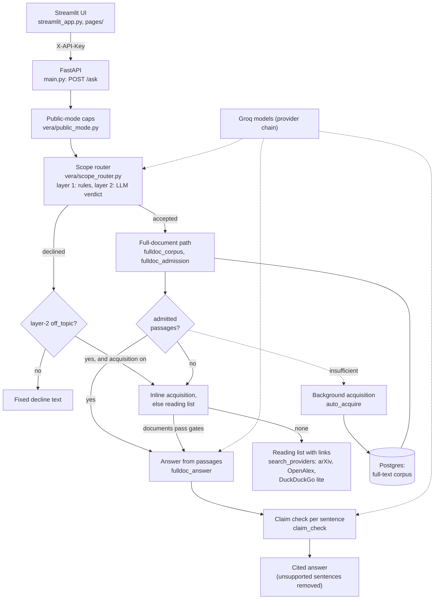

# VERA-DAR

**Verifiable Evidence-based Research Answers**

VERA-DAR is an experimental research assistant that answers a question only from full-text documents it has checked, and shows which passage supports each sentence. When it cannot do that, it says so and gives a reading list of links instead of a guess. It was built during the AI engineering bootcamp capstone (TAI Labs Agentic AI Engineering Bootcamp, 2026).

**Status, 2026-10-23:** Demo Day candidate (the deployed build is shown in the interface footer). Two Render services (a FastAPI API and a Streamlit UI) and a Postgres database work end to end in offline tests. The discovery-to-answer acquisition described below is offline-tested only; it has **not been validated live in production**, and the production API build may predate it unless the owner has deployed it. The claim that VERA-DAR beats leading language models **has not been demonstrated**.

## The problem

Language models write fluent research answers without showing how the evidence was found or read. A citation list does not prove the sources were examined, or that the answer follows from them.

VERA-DAR asks a narrower question: if the system acquires a full document, admits only the passages that bear on the question, and checks each answer sentence against the passage it cites, is the result easier to trust and to audit? Two things are needed: traceable evidence decisions, and an answer that is actually better. Neither substitutes for the other.

## How it works

What each step does:

1. **Scope check.** Layer 1 is a deterministic rule set (`config/scope_router.json`) that hard-blocks explicit personal advice, operational harm, prompt injection and coding tasks. Anything unsure goes to layer 2, a Groq model that returns a JSON verdict. A declined question gets a fixed text, never model-written text. The scope is published research on AI-assisted software development, epidemiology, climate science, research reproducibility and ecology.
2. **Full-document retrieval and admission.** Passages are retrieved from a small, operator-selected, licence-checked collection of full documents stored in Postgres. Each passage is evaluated and admitted or rejected with a reason code. No admitted passage means no generated answer.
3. **Answer and claim check.** The model writes from up to six admitted passages with numbered citations. A second model call judges each cited sentence against its passage. Unsupported sentences are removed, and if none survive, no answer is shown.
4. **Discovery and same-request acquisition.** Discovery is DuckDuckGo first (used only as a pointer to scholarly identifiers), then OpenAlex, Europe PMC, DOAJ and arXiv, through a portal registry (`config/portal_registry.json`; the optional portal-use recorder is off by default). Acquisition runs inside the request when the collection has no answer (a corpus miss) or when the cited corpus content was added more than 24 hours ago (freshness check, `config/auto_acquire.json`). Full text comes from Europe PMC (JATS XML), or from arXiv HTML only for a specific paper version whose own licence link is CC BY, BY-SA, BY-NC or BY-NC-SA, with the route evidence recorded. A document is admitted only as full text: abstract-only records are never admitted. It must also pass the licence gate, content and injection checks and a per-document relevance gate. Documents with enough relevant passages are added to the collection. Each request ends with a research outcome report saying what was tried, what was admitted and why candidates were not. A best-effort background job can follow; it lives in process memory and is lost on restart. Bounds are in `config/auto_acquire.json` (for example 6 jobs per hour, 30 per day, 2 documents per job). A kill switch, `VERA_AUTOACQ_DISABLED=1`, turns acquisition off.
5. **Reading list fallback.** Otherwise the response is a list of published documents that may be relevant, with links, from the search providers above. VERA-DAR has not read those documents, and the response says so.

Answers from acquired documents carry a notice, and a question outside the scope can be answered only from open-access documents found for it, with a stated warning that the answer may be wrong.

## Stack

Python, FastAPI and Uvicorn (API service), Streamlit (UI service), Pydantic, SQLAlchemy with psycopg2 on Postgres, the OpenAI-compatible client pointed at Groq (`openai/gpt-oss-20b`, then `openai/gpt-oss-120b`, for scope and answers; claim checking tries `qwen/qwen3.8-27b` first, then `openai/gpt-oss-120b`; the OpenAI fallback is off by default), defusedxml for JATS full-text conversion, pytest, Docker, and Render for hosting: one Render service for the API (`./start.sh api`), one for the UI (`./start.sh ui`), plus a Postgres database (see [Deployment](docs/deployment.md)). Dependencies are pinned in `requirements.txt`.

## Try it

- Live demo: https://vera-dar-demo.onrender.com (free-tier hosting; the first request after idle can be slow while the service wakes).
- Recording: **OUTSTANDING.** No walkthrough recording has been made as of 2026-10-22. A 30-60 s clip and a full backup run will be linked here once they exist.

<!-- LIVE-RESULT -->
- Locally: see [Development](docs/development.md). The API needs a key (`X-API-Key` header) and a Groq key in the environment. Without a configured full-document corpus source it returns reading lists only.
- Container entry point `start.sh` refuses to run unless `RENDER=true` or `VERA_ENV_CONTEXT=production` is set; locally use `run.sh` / `run_demo.sh`. Untested (assumed) for a fresh machine.

Endpoints: `POST /ask`, `GET /health`, `GET /version`, `GET /corpus-summary` and `GET /health/dar` (API key), `GET /trace/public` (no key), `GET /trace/private` (separate key), and owner-only memory review routes (`X-Owner-Key`). See [API and data use](docs/api.md).

## Evaluation: what has been measured

Numbers below are small-sample and not comparable with each other.

**Scope-router fix (OFFLINE LAYER-1 SCOPE-ROUTER measurement, not an answer success rate).** The earlier scope rules blocked topic words such as "medicine" or "stocks", so legitimate research questions were refused. The fix replaces topic blocking with intent-based rules. Measured on the 85-probe set the fix was developed against (48 that should pass, 37 that should be blocked; not held out), run against layer 1 only and reproduced independently twice:

| Measure (offline layer-1 scope router) | Before | After the fix |
|---|---:|---:|
| Benign questions wrongly blocked | 34/48 | 0/48 |
| Should-block questions caught | 28/37 | 36/37 |

These count how the rule layer routes questions. They say nothing about whether an answer was correct. Limits: layer 1 only, no model calls; the probe set was written by a verifier agent before the fix, was used while developing it (three probes appear in the tests), is not held out and has not been externally reviewed; one operational-harm probe still passes layer 1 and relies on layer 2. Real-model layer-2 behaviour under the new prompt is untested (assumed).

**Historical TRACE v1 (2026-10-04, abstract-grounded variant, SUPERSEDED; not the current full-document system).** An earlier question-only baseline against an abstract-grounded variant, same model, frozen checks:

| Measure | Direct baseline | Abstract-grounded variant |
|---|---:|---:|
| Citation present (22 applicable cases) | 1/22 | 10/22 |
| No phantom evidence (22 applicable cases) | 4/22 | 17/22 |
| All checks passed, dev set (20 questions; the variant had 1 error) | 2/20 | 3/20 |
| All checks passed, held-out set (10 questions) | 2/10 | 2/10 |

Citation-related measures improved; the overall pass rate did not. The current default no longer grounds on abstracts, so these results do not describe the current system. See [Evaluation](docs/evaluation.md).

**Historical TRACE results.** The Trace Eval page shows a historical aggregate and the method and limitations, without secrets. These results were run on an earlier build (0094955) and are HISTORICAL: no before/after measurement of the current pipeline has been made, and no evaluation of the current discovery-to-answer path has been published. They do not show that the current system passes.

**Not measured (as of 2026-10-23):** answer quality of the current full-document path, any comparison with other systems, the accuracy of the claim checker, and live production behaviour of discovery-to-answer acquisition.

## Memory and what is stored

Five questions, answered from the code of this candidate:

1. **What persists?** The evidence corpus: open-access full-text documents the operator selected or that automatic acquisition added (title, landing URL, licence, full-text chunks, provenance). **User memory is off**: no visitor profile, no conversation memory, and the question and the derived search query are not stored. `memory.store.enabled` is `false` in `config/ask-provider-chain.json`, and the owner review routes (`/memory/...`) return 503.
2. **When is it written?** After a question is accepted, when a fetched open-access document passes the licence, content, injection and relevance checks. This can happen inside the request (inline acquisition) or in a queued background job, bounded by `config/auto_acquire.json` (6 jobs/hour, 30/day, 2 documents/job; kill switch `VERA_AUTOACQ_DISABLED=1`). Documents with too few relevant passages are used for that one answer only and not saved.
3. **Where does it live?** In Postgres (documents, chunks and provenance), written through the app's write account.
4. **How is it retrieved?** Stored documents are loaded into an in-process index (BM25 passage search, `vera/fulldoc_corpus.py`, `vera/dar_corpus.py`); the acquired set is refreshed in the background, at most every 300 s. Retrieved passages go through admission and the claim check before they can support an answer. (The disabled user-memory feature, if enabled, would recall only owner-confirmed rows by term matching, with a 30-day TTL and 14-day half-life.)
5. **When is it removed?** No removal mechanism for corpus documents was found in the application code or the repository's SQL (a search for delete, truncate and expiry paths outside tests, as of 2026-10-22; the corpus store is written insert-only, `vera/dar_store.py`). Documents are kept until the operator removes them by hand in the database, and the public deployment is planned to end by 2026-10-31. Only the disabled user-memory feature has an expiry (TTL and owner rejection).

Other settings: discovery notes are written only when the `L2` layer is enabled (the shipped contract lists `L0` only), and corpus admission of abstract-level sources is off (`corpus.enabled` is `false`).

## Privacy and data handling

Every page of the demo shows one data-use disclosure, built from the live configuration in `vera/disclosure.py`. With the shipped configuration its closing text says that the question is sent to third-party AI and search services, that VERA-DAR does not save the question or information identifying the user, and that its collection may grow with open-access full text found while searching. When the optional full-document path answers from the collection, the question, the selected passages with their titles and links, and draft answer sentences are sent to third-party AI services.

What the code shows:

- Acquisition runs inside the request (inline, including for in-scope questions) and can also queue a background job. Terms from the question go to Groq (scope, answering, claim checking) and to the search services: DuckDuckGo, OpenAlex, Europe PMC, arXiv and the Wikipedia API.
- Stored: acquired open-access documents (title, landing URL, licence, full-text chunks, provenance). Not stored: the question or the derived search query. The question is held in memory only for a queued job (maximum age 600 s).
- Request caps and rate-limit counters are held in process memory, and the DuckDuckGo query cache is disabled in the demonstration configuration; see [API and data use](docs/api.md).
- Provider retention, and the hosting platform's standard access logs (client IP, path, status), are outside VERA-DAR's control.

Records written by earlier configurations are not erased by this configuration.

## Limitations

- Full-document answers need a configured corpus source; the collection is small, so most questions get a reading list or a decline.
- Claim checking is done by a language model and can be wrong.
- Thresholds are placeholders pending calibration on live data.
- Licence labels come from indexing services and publisher XML and are not verified with rights holders. For listed results whose full text was not acquired, the label reads "Index metadata: <id>; article licence not verified" only when the licence check allows the record and the index declares a licence (for example CC0 for the index record); without a declared licence it reads "article licence not verified (link only)", and held or rejected records keep their hold or reject label. None of these is a licence for the article.
- The scope router's layer 2 and the off-topic category accuracy are uncalibrated.
- Comparative superiority over frontier models is unproven.
- Discovery-to-answer acquisition is offline-tested; it is not live-validated in production. Other live behaviour is untested (assumed) in this document; the free-tier host can be slow on first request.
- Known gaps in the acquisition fallback path: its fetch step does not yet reject a URL with a port or userinfo when no redirect chain is set (the arXiv licence gate does reject them); an unsigned evidence marker remains an open recorded residual risk (RR-1); and a missing or unparseable corpus timestamp is repaired in memory only unless the app has write access, so the repair is not persisted without a grant.
- The background acquisition queue is best effort and in memory; queued jobs are lost on restart.
- No removal mechanism exists for stored corpus documents (see Memory, answer 5).
- No recording exists yet (OUTSTANDING).

## Documentation

| Resource | Contents |
|---|---|
| [Documentation index](docs/README.md) | All published documents |
| [API and data use](docs/api.md) | Endpoints, response semantics, privacy |
| [Development](docs/development.md) | Local setup and tests |
| [Deployment](docs/deployment.md) | Docker and Render |
| [Architecture](docs/architecture.md) | Conceptual architecture and gaps |
| [Evaluation](docs/evaluation.md) | TRACE method, results, limits |

## Credit

Built during the AI engineering bootcamp capstone (TAI Labs Agentic AI Engineering Bootcamp, 2026) and published for education, evaluation and portfolio purposes.

Copyright (c) 2026 Tagg Maiwald. All rights reserved. [OWNER: confirm this line]
