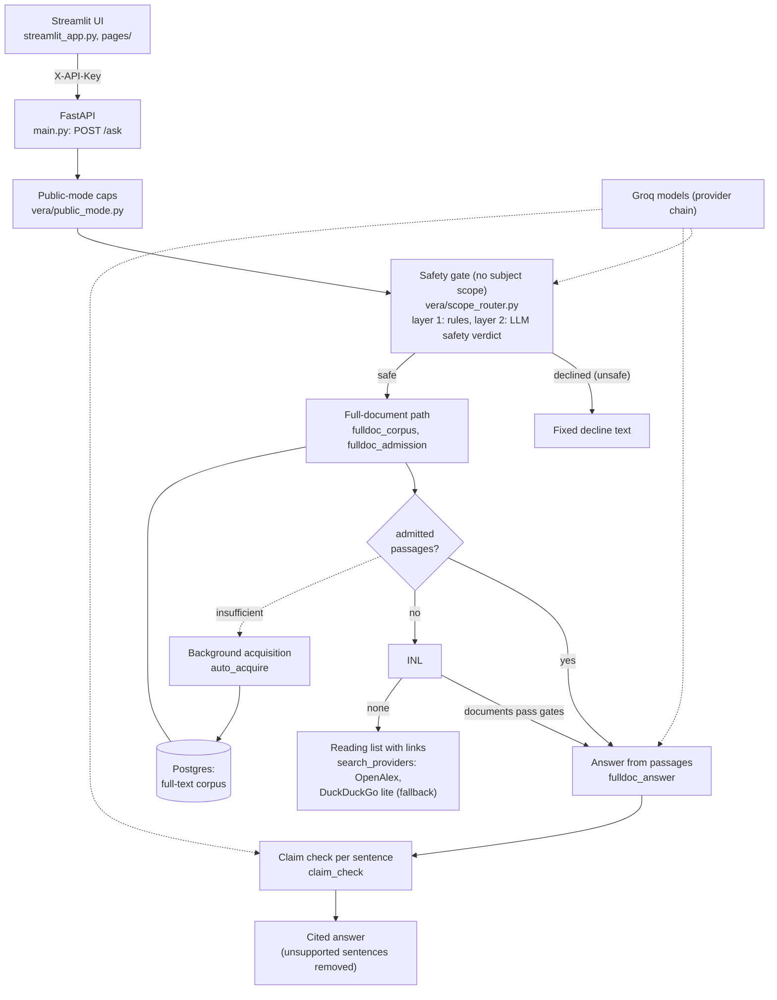

# VERA-DAR

**Verifiable Evidence-based Research Answers**

VERA-DAR is an experimental research assistant that answers a question only from full-text documents it has checked, and shows which passage supports each sentence. When it cannot do that, it says so and gives a reading list of links instead of a guess. It was built during the AI engineering bootcamp capstone (TAI Labs Agentic AI Engineering Bootcamp, 2026).

## Status

**As of 2026-11-06** (repo HEAD b20ad8c; *annotation 2026-11-08: the repository has since advanced to c8c1daa with many 2026-11-08 commits, for example robots policy, API permission allowlist and URL gate, purpose grants, taxonomy registry and Corpus page changes, see `git log`; the verification and not-live statements below were not redone for them*): the course ended on 2026-10-25 (the 2026-10-23 Demo Day candidate is history). The production deployment is planned to run through 2026-11-30 (owner decision OD-1027, 2026-10-27; this supersedes the earlier end date). Render is the interim host; a non-Render host is planned. The deployed build is shown in the interface footer. A FastAPI API and a Streamlit UI (two Render services) and a Postgres database work end to end in offline tests. Offline release verification passed for b20ad8c (see [Release checks](docs/release-checks.md)); the live catalog check, gate (a2), is run by the owner at deploy time. The discovery-to-answer acquisition, the 2026-11-04 changes listed below (safety-only gate, acquisition rounds, request trace, news lane, corpus digest) and the later fixes are offline-tested only; they have **not been validated live in production**, and the production API build may predate them unless the owner has deployed it (check the footer build against the repository). The claim that VERA-DAR beats leading language models **has not been demonstrated**. No walkthrough recording was known to exist as of 2026-10-22 (not re-checked since). No measurement of the current system has been published (see [Evaluation](#evaluation-what-has-been-measured)).

**Update 2026-11-10 (DOCS-B6-1110; read from the code and `config/` at batch-6 release candidate d3fe0fe; offline-tested only, live unverified; nothing here was observed live).** Where this paragraph conflicts with the 2026-11-09 paragraph below it, this one governs.

- *Hybrid retrieval ships OFF.* `config/hybrid_retrieval.json` `enabled` and `rerank.enabled` are both `false` at d3fe0fe (commit 4d9816f), so there is no embedding call and retrieval is word-only. The 2026-11-09 description of hybrid retrieval below stays valid for what the code does when an owner turns the flags on; its "`enabled` true" is **superseded**. `stem_floor_sim` still holds the placeholder `FILL_FROM_CALIBRATION`, so that one admission rule stays off even then.
- *Portal rule (OD-1110-PORTALS-ALL).* `vera/host_role.py` reads the reviewed policy `config/host_roles.json` and gives each host one role: ORIGINAL, REPOSITORY_OF_RECORD, PORTAL, RESOLVER or EXCLUDED (more specific rows win; a tie goes to EXCLUDED, then PORTAL, RESOLVER, REPOSITORY_OF_RECORD, ORIGINAL). Only ORIGINAL and REPOSITORY_OF_RECORD hosts can supply evidence; the repositories of record in the file include OSTI, NASA NTRS, Zenodo and HAL, and Europe PMC, PMC and ERIC for specific article paths only (their hosts default to PORTAL). A portal's own text, abstract or snippet is never evidence, whatever any other flag says; only a reviewed edit of the file changes a role. Preprint servers (arXiv and its mirrors, bioRxiv, medRxiv, SSRN and others), indexes (OpenAlex, INSPIRE, Crossref, DOAJ, Semantic Scholar) and Wikipedia are PORTAL. For full-text storage an unknown host is denied, and for an answer it is allowed; an invalid file denies both. Item #79 corpus admission is separate (see the last bullet of this paragraph).
- *Portal records are followed, never read (`portal_follow`).* `config/portal_follow.json` `enabled` is `true`. For the most relevant portal records of a question (at most 3 records, 6 metadata lookups and 6 s per question), links and identifiers are followed through metadata lookups only until a host role of ORIGINAL or REPOSITORY_OF_RECORD is reached, and the reading list can show that resolved original. OpenAlex lookups stay **off** (`auto_acquire.json` `arxiv_portal.openalex.enabled` and `reference_portals.json` `adapters.openalex_rw` are `false`, pending a terms review); INSPIRE reference lookups are on (`adapters.inspire_refs` `true`).
- *arXiv is a portal, not a source.* `auto_acquire.json` `arxiv_route.enabled` is `false` and the route is also closed in code (`vera/arxiv_fulltext.PORTAL_ONLY`). An arXiv-only candidate is resolved to its published version and references through INSPIRE metadata and enters acquisition on its original host. *This supersedes the arXiv HTML full-text route described in step 4 of "How it works" and in the 2026-11-04 notes.*
- *List ingest.* `POST /ingest/list` queues known identifiers (DOI, PMCID, `pmid:N`, arXiv id or URL) without any web search, at seed priority, through the unchanged acquisition gates (Europe PMC resolve, robots/TDM, licence, injection, relevance). It is authenticated with its own key in the header `X-API-Key`, set as `VERA_INGEST_API_KEY` on the API service only; while that variable is unset, weak or equal to `VERA_API_KEY` the route answers 503. Gates (`config/list_ingest.json`): 25 identifiers per call (the request model allows 500; more than 25 gets 413), 60 per hour and 300 per day, 2 queue places reserved for visitors, 5 arXiv lookups per call. `GET /ingest/list/outcomes` reads the per-item final codes held in memory (lost on restart). Details: [API](docs/api.md).
- *DuckDuckGo is a fallback only.* `config/ddg_reduce.json` switches all ship `true`: DuckDuckGo is used only when the other routes return fewer than 3 relevant results (`ddg_fallback_min_results`), one site group per call, not on acquisition variant rounds, and not on a search for new documents after an answered, sufficient and fresh non-news question. The daily cap is unchanged at 8 queries (`config/vera_eval_run.json`). Seed (list-ingest) work never uses it (`origin.seed_allowed` is `false` for DuckDuckGo in `config/rate_limits.json`). **Superseded:** "Discovery is DuckDuckGo first" in step 4 below. The diagram below was updated in place (search_providers: OpenAlex, then DuckDuckGo lite as fallback) and shows the current order. OpenAlex search with `OPENALEX_API_KEY` set is capped at 1000/day (keyless 90), and a seed request stops at half of the cap so the rest is kept for visitors. The Wikipedia search API (`api_permissions.json` `wikipedia_search_api`) is switched to `deny` (robots-first), so it makes no call.
- *Settings registry (ships off).* `vera/settings.py` can overlay allow-listed numeric tunables and deny-list entries from database rows over the JSON files, only for modules set to `true` in `config/settings.json` `read_from_db`; the shipped value is `{}` (every module reads files only). The keys are pinned by `config/settings_registry.json` (hash-checked), values are type-, range- and direction-clamped against the file value, and the database never supplies allow entries. The tables come from migration 026, which is a draft in `db/migrations/pending/` and **not applied**; do not turn any module on before the owner applies it. Without the tables a read falls back to the files.
- *Chunk-value rules (off).* `vera/chunk_value.py` is a pure rules module (keep/drop rules for chunks and documents) and `config/chunk_value.json` `enabled` is `false`; nothing in `vera/`, `main.py` or `scripts/` imports it at d3fe0fe, so it has no caller yet.
- *Chunk taxonomy: multi-links and self-reporting.* `config/chunk_taxo.json` `params.multi.enabled` is `true`: besides the strict link (`score_kind` `cosine`) a chunk can get routing-only links to nodes near its best one (`cosine_r<rank>`, up to 4 subtopic, 3 topic and 3 domain links, and `cosine_soft` for an outlier), written by the taxonomy job through the app path. Display counts use `score_kind` `cosine` only. `config/taxo_router.json` `mode` is `off`, so nothing reads the extra links yet. `chunk_usage.enabled` is `true` with `demote.scale` 0; it is inert until the tables of draft migration 025 exist. The taxonomy job reports on itself: at start it logs the first-pass delay and, by name only, any missing Cloudflare credential variable (`CLOUDFLARE_ACCOUNT_ID`, `CLOUDFLARE_API_TOKEN`), and the API pages read its last finished run through `vera/chunk_taxo_status.py`.
- *#79 corpus admission (ships with the follow-up batch, followups-1110; not part of d3fe0fe).* #79 corpus admission stores metadata and refuses only PORTAL and EXCLUDED records (unknown hosts and doi.org journal DOIs pass); the evidence rule is unchanged.
- *Scope and wording.* The scope router accepts questions up to 4000 characters (`vera/scope_router.py` `API_QUESTION_MAX_CHARS`). Unverified: the user-visible label and notice wording changes of this batch were not re-read for this paragraph.

**Update 2026-11-09 (DOCS-1109; read from the code and `config/` at c3aabb1, offline-tested only; nothing here was observed live; the flags below are on from this release).** Features in the source tree and shipped config:

- *No cap on stored documents (OD-1109-NOCAP).* Every stored acquired document is served to internal search; the `served_acquired_max`, byte and scan caps are removed. The BM25 index is compact (chunks are offsets into the document text with shared postings, `vera/dar_corpus.py`) and a refresh that only finds newer rows appends to a fork of the serving corpus instead of rebuilding it (`vera/fulldoc_db.py`, `vera/fulldoc_corpus.py`; probe at most every `serve.refresh_ttl_s` = 300 s).
- *Six new documents per question (OD-1109-SIX).* Every grounded answer also runs one inline acquisition (`always_acquire_new`) whose rounds aim at 6 new documents (`acq_round_target_new_docs`); already stored documents do not count. Fewer is a resource limit, not an error. Portal pages can lead to one further eligible portal page (`config/reference_portals.json` `caps.max_hops` 2), and an on-question reference may lead to its original host (`classifier.follow_origin`, OD-1109-ORIGIN) through the unchanged per-hop gates (public-address check, robots.txt, AI-use signals, licence, rate limit); content from an original host is used for that answer only and is not stored.
- *Quota.* One acquisition job per question (`acq_rounds_one_job`); `jobs_per_hour` 120 (OD-1109-QUOTA) and `jobs_per_day` 2000 (OD-1109-DAILYCAP); `docs_per_day` is null (no daily document cap).
- *Multi-question prompts (MULTIQ, `config/multi_question.json`).* `mode` is `on`: a prompt with 2 or more questions (split on grammar only, at most `max_questions` 3) is routed and answered or refused per question, one section each. The streamed path caps searches per question at `stream_rounds_per_question` 2; the cap, like `max_questions`, is provisional and uncalibrated. A multi-part question is not split.
- *Filler words.* Generic filler words are dropped from the retrieval query as whole words only (a plain plural also matches, never a prefix), except words in a run of two or more capitalised words or inside double quotes (`vera/fulldoc_admission.py` `retrieval_kept_words`, `_name_protected`; `retrieval_drop_generic` in `config/fulldoc_answer.json`).
- *Chunk taxonomy (mechanical).* `vera/chunk_taxo*.py`, `config/chunk_taxo.json` (`enabled` true): Cloudflare Workers AI `@cf/baai/bge-m3` embeddings, seeded k-means clustering, nearest-center assignment, c-TF-IDF term names. Daily neuron budget 8000, of which 5000 is reserved for ask-time use, so the background job stops at 3000. The job halves its embed batch above `rss_soft_mb` and stops above `rss_hard_mb`, and defers a build when current memory plus the estimate would exceed `rss_hard_mb`. Vectors are stored in `vera_vjay.tax_chunk_vectors` (migration 024) and 022 is needed for the job to write taxonomy nodes, anchors and links (without it the job only computes); both migrations were applied by the owner on 2026-11-09 (owner-reported; details in `db/README.md`). The Corpus page display gate is separate and unchanged in purpose.
- *Hybrid retrieval (`config/hybrid_retrieval.json`; *superseded 2026-11-10: `enabled` and `rerank.enabled` are now false, see the Update 2026-11-10 paragraph*; the text below describes the code when the flags are on).* BM25 candidates are fused by reciprocal rank fusion (`rrf_k` 60) with a vector list built from stored-partition vectors. At ask time up to 48 passages (`rerank.max_passages`) of the top 3 partitions are embedded in one call and ranked by cosine as a third input. Each question is embedded once (timeout 3 s, one attempt, 60 s cool-down after an error; quota or budget stop waits until 00:00 UTC). Any failure falls back to word-only search. Request-path lock waits are bounded (2 s), embedder creation is single-flight (a stale creator is presumed dead after 30 s), and the vector index is built in a background thread. `stem_floor_sim` is set by a one-off calibration at switch-on time; if it is still null or the placeholder string (`FILL_FROM_CALIBRATION`), the code ignores it and only that one admission rule is **off** while the rest of hybrid retrieval runs. Requires environment variables `CLOUDFLARE_ACCOUNT_ID` and `CLOUDFLARE_API_TOKEN` (names only; see [Deployment](docs/deployment.md)); without them the embedder is not created and retrieval is word-only.

**Update 2026-11-06 (DOCS pass CATCHUP-1106B; repo HEAD b20ad8c).** Offline release verification passed for b20ad8c (verdict PASS; full suite 9680 passed, 61 skipped, 12 xfailed, about 3 minutes; offline golden evaluation 0 fail). Gate (a2), the live catalog check, is not run offline: the owner runs it at deploy time. Not deployed or live-validated.
- **Names.** VERA = Verifiable Evidence-based Research Answers. -DAR = Domain-Aware Retrieval. -MAGOPS = Multi-Agent Operations: a planned, proposed multi-agent control plane, not part of this service (OD-1106-ABOUT-DARMAG; the About page carries both lines in `config/ui_help_pages.json` `about.opening_expansions`).
- **Golden question set (OD-1106-EVAL).** A standing 52-question golden set and an offline replay are maintained in the workspace (not in this repository). The offline replay is a blocking step in release verification; live golden evaluation is owner-run and report-only until two live baselines exist, and no live gate exists. No live baseline has been published.
- **Robots and AI agents (OD-1106-ROBOTS-AI), pending release.** The owner decided that robots.txt blocks on well-known AI-agent groups, or blanket statements that AI crawlers are blocked, apply to VERA-DAR's fetcher too (deny by default). The matcher change is not shipped: the fetcher in this tree does not yet implement it. *Superseded 2026-11-08 (DOCS-1108): `vera/robots_ai.py` and `config/robots_ai.json` now implement robots verdicts, and under OD-1108-DISPOSITIONS-2 H13 (quoted in that module's docstring) hyperscaler-only robots groups are advisory for independently identified VERA-DAR agents, while wildcard, VERA-specific, AI-use, TDM and terms restrictions are still enforced. The "not shipped" statement above is out of date; live behaviour unverified.*
- **No-derivatives (ND) news (OD-1106-NEWS H19).** Implemented behind a flag that is off. Until noncommercial eligibility and the publisher's access terms are confirmed, such outlets stay link-only; robots permission alone is not treated as copyright or AI-use authorization.
- **PDF route (H20).** Flag off and unshipped. Zenodo is the first host; LSE Research Online is restricted for VERA-DAR and has no host entry. *Checked 2026-11-08 (DOCS-1108): `config/auto_acquire.json` `repository_pdf_route.enabled` is still false; ND status below: `config/reporting_lane.json` `nc_basis.status` is still `UNCONFIRMED`, so ND rows stay link-only.*
- **Update 2026-11-08 (DOCS-1108; read from config and `git log`, repo HEAD c8c1daa; c8c1daa was deployed and passed the post-deploy check on 2026-11-08; the individual features below were not validated live beyond that check).**
  - *API allowlist and URL gate.* `config/api_permissions.json` is a deny-by-default allowlist for outbound API calls (no matching entry means denied, no request sent); `config/api_like_patterns.json` makes the generic fetchers refuse an API-like URL with no entry, and an IP-literal host, failing closed (commits a9b3af4, 7b1a57b, befefe0, 3d3a5fc).
  - *Purpose grants.* `config/purpose_grants.json` is in `mode` `shadow`: it records what would be admitted under an educational or research purpose grant from site-owner channels and changes no admission; there is no `on` mode (commits 9eeb33d, 859b433).
  - *Taxonomy.* *Superseded in part (2026-11-09): see the Update paragraph above for the chunk taxonomy and hybrid retrieval; 022 and 024 were applied 2026-11-09, status in db/README.md.* `vera/tax_registry.py` is inert registry code (migration 020 was applied by the owner on 2026-11-08; 022 is a draft, not applied; status in db/README.md); the hierarchical matcher `config/taxo_hier.json` is `off`, UNCALIBRATED (commits b98c605, 3027e54).
  - *Corpus page.* A Corpus Description page (`pages/corpus_description.py`) shows the interim presentation (commit 2fa9d39; restored 2026-11-09 under OD-1109-HD3): the checked written description or frequent subject phrases from titles, the total document count and the publication-year range, with no per-area percentages, subject shares or inferred subject distribution, until classification quality is validated. *Superseded (2026-11-09, OD-1109-HD3): the earlier wording "describes the collection by subject area, with per-area percentages and Other / mixed last (commits 2fa9d39, fccb8ca); the subject shares are provisional and unvalidated" (fccb8ca is reverted).*
  - *Robots.* See the robots bullet above and commits cf62a55, c9842c0, c8c1daa (page-level no-AI signals, Content-Usage, own-token Crawl-delay); behaviour not described further here because its details were not examined.

## The problem

Language models write fluent research answers without showing how the evidence was found or read. A citation list does not prove the sources were examined, or that the answer follows from them.

VERA-DAR asks a narrower question: if the system acquires a full document, admits only the passages that bear on the question, and checks each answer sentence against the passage it cites, is the result easier to trust and to audit? Two things are needed: traceable evidence decisions, and an answer that is actually better. Neither substitutes for the other.

## How it works

What each step does:

1. **Safety check (before retrieval).** Layer 1 is a deterministic rule set (`config/scope_router.json`) that hard-blocks explicit personal advice, operational harm, prompt injection and coding tasks. Every other question goes to layer 2, a Groq model that returns a JSON safety verdict; only an exact `safe_request` verdict passes, and anything else (malformed, off-schema or unavailable) is declined. A declined question gets a fixed text, never model-written text. Subject matter is never a reason to decline and there is no fixed scope text: whether VERA-DAR's collection can answer is decided after retrieval, from the passages it finds (owner decision SCOPE-GATE-1104, 2026-11-04). The shipped config still has an off-topic reading-list path for layer-2 verdicts; its live behaviour after the gate change is offline-tested only.
2. **Full-document retrieval and admission.** Passages are retrieved from a small, operator-selected, licence-checked collection of full documents stored in Postgres. Each passage is evaluated and admitted or rejected with a reason code. No admitted passage means no generated answer. The model can also flag a false or ill-posed premise in the question, but only with a cited correction that passes the same claim check; an unverified premise flag counts as an evidence miss and starts acquisition.
3. **Answer and claim check.** The model writes from up to six admitted passages with numbered citations. A second model call judges each cited sentence against its passage. Unsupported sentences are removed, and if none survive, no answer is shown.
4. **Discovery and same-request acquisition.** *Superseded 2026-11-10: DuckDuckGo is a fallback only and arXiv is a portal; see the Update 2026-11-10 paragraph.* Discovery was DuckDuckGo first (used only as a pointer to scholarly identifiers), then OpenAlex, Europe PMC, DOAJ and arXiv, through a portal registry (`config/portal_registry.json`; the optional portal-use recorder is off by default). Acquisition runs inside the request when the collection has no answer or too little (a corpus miss or an insufficient result) or when the cited corpus content was added more than 24 hours ago (freshness check, `config/auto_acquire.json`). Full text comes from Europe PMC (JATS XML), or (*superseded 2026-11-10: the arXiv route is off*) from arXiv HTML only for a specific paper version whose own licence link is CC BY, BY-SA, BY-NC or BY-NC-SA, with the route evidence recorded. When the first search leaves fewer than six usable documents, further rounds use other query variants, up to six full texts per prompt; a round that finds fewer than six reports a resource limit, not an error, and the loop stops after two rounds with no new usable document (offline-tested only; six is an owner-declared target, not calibrated). A licence allowlist (`config/licence_allowlist.json`; Deny All: only listed licences are stored, ND and no-education-use licences are rejected) decides storage; documents without an allowlisted licence are not stored. A document is admitted only as full text: abstract-only records are never admitted. It must also pass the licence gate, content and injection checks and a per-document relevance gate. Documents with enough relevant passages are added to the collection. Optional lanes can add pages read for one answer only (see Search lanes below). Each request ends with a research outcome report saying what was tried, what was admitted and why candidates were not. A best-effort background job can follow; it lives in process memory and is lost on restart. Bounds are in `config/auto_acquire.json` (for example 120 jobs per hour (one job per question, OD-1109-QUOTA), 2000 per day (OD-1109-DAILYCAP), 2 documents per background job, up to 31 documents stored by one live prompt, and 30 prompts per hour and 180 per day per client (owner decisions OD-1031-PROMPTLIM and OD-1031-CEIL31)). A kill switch, `VERA_AUTOACQ_DISABLED=1`, turns acquisition off.
5. **Corpus digest.** `GET /corpus-summary` returns a model-written digest of the stored collection. A claim-level checker accepts only statements that match recorded facts and approved fact phrases; coverage figures are computed by code, not by the model. The latest digest is stored in the database so it survives a restart (`config/request_trace.json` `digest_store`; offline-tested, live behaviour unverified).
6. **Reading list fallback.** Otherwise the response is a list of published documents that may be relevant, with links, from the search providers above. VERA-DAR has not read those documents, and the response says so.

Answers from acquired documents carry a notice. When the collection is insufficient for a question, VERA-DAR searches for and reads more open-access full texts in the same request before answering; with automatic search off it returns the reading list and says that search is off.

### Search lanes (2026-11-04/05)

**Update 2026-11-06 (NEWS-BATCH-2, DOCS-NB2-1106; read from the working tree, offline tests only, nothing verified live).**
- **Wikipedia citation news links (NT-3).** Links cited by Wikipedia articles can be shown as link-only news items credited "via Wikipedia citations" (`vera/lane_evidence.py` `wiki_link_items`, `merge_wiki_links`; `vera/wiki_ref_portal.py` keeps the links). They are never fetched, never evidence and never counted as read. Any URL on a Wikipedia or Wikimedia-family host (`wiki_link_drop_hosts` in `config/reporting_lane.json`) and any `exclude` outlet is dropped.
- **Source rules (H5, owner decision OD-1106-HITL).** `config/entity_registry.json` has FEC and Census Bureau rows (active, static pages only, `verification.status` `owner_decided_unverified_paths`: robots.txt and path layout were not fetched when added) and an EAC row that is `suspended` (terms unverified, never loaded). The Official lane flag stays **off**. In `config/reporting_lane.json`: `voanews.com` is read in full only for `/a/<slug>/<id>.html` pages with a "By VOA News" byline and no wire-service marker; `en.wikinews.org` is read from `/wiki/` mainspace only and is an archive (the site is closed and read-only; the closure date is summary-grade evidence); `propublica.org` and `theconversation.com` are `exclude` (dropped); `pbs.org` is link-only.
- **Search relevance.** A bare year (for example 2026) is no longer a central concept, is not used as a search variant and, in the arXiv query, is ANDed with topic terms (F1). A hyphenated or spaced compound such as multi-agent counts as one concept that outranks its parts (R1), except that a compound match backed only by reinforcement-learning vocabulary, with no LLM cue, stays weak for a question with an LLM or orchestration sense; framing idioms such as "de facto status quo", "status quo best practices" and "best practices" are removed from news search terms (R2) while a plain "status" is kept, and "status quo" itself still counts as a time cue in political questions (framing uses such as "status quo bias" do not); the arXiv query ANDs the compound and drops bare one-word variants (R3); British and American spellings match, for example colour and color (R4).
- **Counts in the interface.** The evidence scope line splits documents from VERA-DAR's collection from documents fetched for this question (SCOPE-COUNT). The no-answer headline reads, for example, "VERA-DAR checked 30 full documents; passages from 2 looked related, but they did not support an answer, so it has not answered." (R8).
- **News-access module (H19).** `vera/news_access.py` derives a full-text or link-only mode for no-derivatives outlets and `scripts/news_access_report.py` prints the outlets that resolve to link-only. Both are offline and read no database. Nothing in the lane calls the module yet; the shipped config has no `nc_basis`, so every such row would resolve to link-only until the owner records NC-BASIS-1 as `SATISFIED`. *Superseded in part (2026-11-08, DOCS-1108): `config/reporting_lane.json` now has an `nc_basis` block with status `UNCONFIRMED`, so the outcome is unchanged (link-only); some outlet rows carry summary-grade `nc_eligible` entries, which do not override that gate.* A migration for an exceptions table exists only as a `.draft` file under `db/migrations/pending/` and `db/migrations/rollback/`.
- **Repository PDF route (H20; see the 2026-11-06 update above).** Only configuration exists: `config/repository_pdf.json` (Zenodo the only host, status `pending`, so never used) and `repository_pdf_route.enabled` false in `config/auto_acquire.json`. The cap values are provisional. The extraction worker module is not present in the tree; its tests skip.
- **Interface.** The Ask page shows one line under the question box, "By asking, you agree to the Terms", linking to the Terms page (H14; wording in `config/ui_help_pages.json` `ask_terms_notice`; a notice of terms, not a record of consent). The short AI notice and the header links to About and How to use were removed from the other pages, and the second About link in the sidebar was removed (the navigation entry remains). The About page opens with "VERA: Verifiable Evidence-based Research Answers" (config `about.opening`). Long disclosure text stays on About only. Progress: "saved" never shows more than its target, the slow-read activity reads "Still reading N source(s) at once; the slowest has taken S s", and count-only updates are collapsed in the log.

- **Current-reporting (news) lane:** enabled in config on 2026-11-04 (`config/reporting_lane.json`). It queries GDELT and may read pages only from an owner-vetted outlet list; outlets with links-only terms are listed, never read. Hacker News search is excluded. Pages read are used for that answer only, not stored. Live behaviour in production is **untested** (a GDELT field check returned 200 on 2026-11-04; the lane itself has only offline tests).
- **Official-sources lane:** built but **off** (`config/subquery.json` `official_lane.enabled=false`); enabling is an owner step, see [Lanes enable checklist](docs/lanes-enable-checklist.md).

## Stack

Python, FastAPI and Uvicorn (API service), Streamlit (UI service), Pydantic, SQLAlchemy with psycopg2 on Postgres, the OpenAI-compatible client pointed at Groq (`openai/gpt-oss-20b`, then `openai/gpt-oss-120b`, for scope and answers; claim checking tries `qwen/qwen3.8-27b` first, then `openai/gpt-oss-120b`; the OpenAI fallback is off by default), defusedxml for JATS full-text conversion, pytest, Docker, and Render for interim hosting: one Render service for the API (`./start.sh api`), one for the UI (`./start.sh ui`), plus a Postgres database (see [Deployment](docs/deployment.md)). Dependencies are pinned in `requirements.txt`.

## Pages and interface

*Annotation 2026-11-08 (DOCS-1108): `pages/` now also holds `corpus_description.py` (Corpus Description) and `terms.py` (Terms) besides the pages named in this paragraph; the list below was not re-derived.* The Streamlit UI has five pages: **Ask VERA-DAR**, **Report**, **Trace Eval** (two tabs: **Historical**, a dated earlier evaluation run that does not describe the current service, and **Live aggregate**, anonymous aggregate statistics that stay off until the owner switches collection on), **How to use** and **About**. In the Ask question box, pressing Enter submits the question.

Disclosure: *Superseded 2026-11-06 (NEWS-BATCH-2): earlier text said every page except About shows the short notice with links to About.* The short notice (an AI system whose answers may be wrong, with the question sent to third-party AI and search services) is now shown on the Ask page only, with no header links; the Ask page also has the Terms line (see the update above). The full disclosure appears only on the **About** page.

## Changes of 2026-11-04 and 2026-11-05

Offline-tested only; live behaviour unverified. Details are in the sections above.

- Safety-only pre-retrieval gate; sufficiency decided after retrieval (SCOPE-GATE-1104).
- Premise-miss fix and acquisition rounds up to six full texts.
- Request trace (migration 015 applied by the owner on 2026-11-04, owner-reported): see Privacy below.
- News lane enabled; official-sources lane built, off; licence allowlist; corpus digest with DB storage.
- 2026-11-05 working-tree fixes (lane trace events, reading-list trace, rate-limit and outcome changes) are uncommitted. *Superseded (2026-11-08, DOCS-1108): the repository history has advanced to c8c1daa, and whether these fixes are committed was not individually checked; treat as out of date.*

## Changes of 2026-11-03 (NONASK-1103)

Status of everything below: **offline-tested only; not deployed; live behaviour unverified.** Nothing here has been run against the production service.

Enabled in code:

- Report page layer order, development-only internals hidden, and Enter-to-submit on the Ask page.
- Trace Eval Historical and Live aggregate tabs; short notice on non-About pages; full disclosure on About only.
- Truthful no-answer causes and plural-correct counts in status text; `contract.no_answer_cause`.
- Evidence trace in `contract.trace` (plain-language reasons passages were selected or not used; fails closed when its label file is missing).
- arXiv as an acquisition provider (own call, own budget slot).
- Recognition of Handle identifiers (`hdl.handle.net/...`, `hdl:`), shown as persistent identifiers; no automatic fetch route.

Prepared for push 2 (offline-tested, not deployed, live unverified; see [Citations](docs/citations.md)):

- APA 7 house variant "identifiers appended": references in the answer area, reading list and Report page (never the sidebar).
- Deterministic sub-query decomposition and per-sub-query adequacy verdicts in the public trace.
- Answer-only, never-stored handling of pages without an open licence (policy in plain words).
- Two search lanes, the Official lane and the Current-reporting lane. Both shipped off on 2026-11-03; Superseded (2026-11-05, by `config/reporting_lane.json`): the Current-reporting lane is now enabled, the Official lane is still off. See [Citations](docs/citations.md#search-lanes) and [Lanes enable checklist](docs/lanes-enable-checklist.md).

Prepared but flag-off (shipped disabled; thresholds are uncalibrated placeholders):

- Topic anchor admission rule (`fulldoc_answer.json`, `topic_anchor.enabled=false`).
- Reading-list relevance floor (`domain_routing.json`, `reading_list_floor.enabled=false`).
- `answer.per_part.keep_partial_parts` (default false).
- Live aggregate statistics (`config/live_stats.json`, `enabled=false`); needs the owner-run draft migration 013, which is not applied (migration 015, a different one, was applied).

## Try it

- Live demo: hosted on Render (interim, free-tier; the first request after idle can be slow while the service wakes). The address is not published in this file; ask the owner.
- Recording: none yet (see [Status](#status)). A 30-60 s clip will be linked here once one exists.

<!-- LIVE-RESULT -->
- Locally: see [Development](docs/development.md). The API needs a key (`X-API-Key` header) and a Groq key in the environment. Without a configured full-document corpus source it returns reading lists only.
- Container entry point `start.sh` refuses to run unless `RENDER=true` or `VERA_ENV_CONTEXT=production` is set; locally use `run.sh` / `run_demo.sh`. Untested (assumed) for a fresh machine.

Endpoints: the main route is `POST /ask` (API key in the `X-API-Key` header). The full endpoint list, keys and response semantics are in [API and data use](docs/api.md).

The `/ask` answer is shown in layers: **Answer**; **Evidence and limitations**; **Research and verification** (collapsed by default, shown when there is something to explain); and **Technical details**, which appear in owner/dev mode only. The layers draw on the response fields `answer`, `answer_status`, `limitations`, `process_notes` and the evidence fields described in [API and data use](docs/api.md). The layered output (2026-11-03) is tested offline only and may not be in the deployed build.

## Evaluation: what has been measured

Numbers below are small-sample and not comparable with each other.

**Scope-router fix (OFFLINE LAYER-1 SCOPE-ROUTER measurement, not an answer success rate).** The earlier scope rules blocked topic words such as "medicine" or "stocks", so legitimate research questions were refused. The fix replaces topic blocking with intent-based rules. Measured on the 85-probe set the fix was developed against (48 that should pass, 37 that should be blocked; not held out), run against layer 1 only and reproduced independently twice:

| Measure (offline layer-1 scope router) | Before | After the fix |
|---|---:|---:|
| Benign questions wrongly blocked | 34/48 | 0/48 |
| Should-block questions caught | 28/37 | 36/37 |

These count how the rule layer routes questions. They say nothing about whether an answer was correct. Limits: layer 1 only, no model calls; the probe set was written by a verifier agent before the fix, was used while developing it (three probes appear in the tests), is not held out and has not been externally reviewed; one operational-harm probe still passes layer 1 and relies on layer 2. Real-model layer-2 behaviour under the new prompt is untested (assumed).

**Historical TRACE v1 (2026-10-04, build 0094955, abstract-grounded variant, SUPERSEDED).** Citation-related measures improved over a question-only baseline; the overall pass rate did not. These results describe an earlier build, not the current full-document system, and do not show that the current system passes. Tables, method and limits: [Evaluation](docs/evaluation.md).

**Not measured (recorded 2026-10-23; no later measurement of these recorded as of 2026-11-05):** answer quality of the current full-document path, any comparison with other systems, the accuracy of the claim checker, and live production behaviour of discovery-to-answer acquisition.

## Memory and what is stored

**Live statistics (off by default).** When the owner enables live stats, one anonymous record is kept per answer (result type, counts, latency, time rounded to the hour; no question text or identifiers). While the flag is off, nothing changes.

Five questions, answered from the code of this candidate:

1. **What persists?** The evidence corpus: open-access full-text documents the operator selected or that automatic acquisition added (title, landing URL, licence, full-text chunks, provenance). **User memory is off**: no visitor profile and no conversation memory. The question is not part of the evidence corpus and the derived search query is not stored; the one exception is the owner-only request trace (see Privacy). `memory.store.enabled` is `false` in `config/ask-provider-chain.json`, and the owner review routes (`/memory/...`) return 503.
2. **When is it written?** After a question is accepted, when a fetched open-access document passes the licence, content, injection and relevance checks. This can happen inside the request (inline acquisition) or in a queued background job, bounded by `config/auto_acquire.json` (120 jobs/hour, one job per question, OD-1109-QUOTA; 2000/day, OD-1109-DAILYCAP; 2 documents per background job, up to 31 per live prompt, 30 prompts/hour and 180/day per client, OD-1031-PROMPTLIM and OD-1031-CEIL31; kill switch `VERA_AUTOACQ_DISABLED=1`). Documents with too few relevant passages are used for that one answer only and not saved.
3. **Where does it live?** In Postgres (documents, chunks and provenance), written through the app's write account.
4. **How is it retrieved?** Stored documents are loaded into an in-process index (BM25 passage search, `vera/fulldoc_corpus.py`, `vera/dar_corpus.py`); the acquired set is refreshed in the background, at most every 300 s. *Superseded in part (2026-11-09): there is no cap on stored documents, and a refresh with only newer rows appends to a fork of the serving index; with hybrid retrieval on, an embedding-similarity list is fused with BM25 (see the Update paragraph near the top).* Retrieved passages go through admission and the claim check before they can support an answer. (The disabled user-memory feature, if enabled, would recall only owner-confirmed rows by term matching, with a 30-day TTL and 14-day half-life.)
5. **When is it removed?** No removal mechanism for corpus documents was found in the application code or the repository's SQL (a search for delete, truncate and expiry paths outside tests, as of 2026-10-22; the corpus store is written insert-only, `vera/dar_store.py`). Documents are kept until the operator removes them by hand in the database, and the public deployment is planned to run through 2026-11-30 (owner decision OD-1027, 2026-10-27; this supersedes the earlier 2026-10-31 end date). Only the disabled user-memory feature has an expiry (TTL and owner rejection).

Other settings: discovery notes are written only when the `L2` layer is enabled (the shipped contract lists `L0` only), and corpus admission of abstract-level sources is off (`corpus.enabled` is `false`).

## Privacy and data handling

*Superseded 2026-11-06: the full text is on About only, the Ask page shows the short notice.* The data-use disclosure is built from the live configuration in `vera/disclosure.py`. With the shipped configuration its closing text says that the question is sent to third-party AI and search services, that VERA-DAR does not save the question or information identifying the user, and that its collection may grow with open-access full text found while searching. When full-document answering (enabled in the shipped configuration, but in effect only when a corpus source is configured; see [Default behaviour](docs/api.md#default-behaviour)) answers from the collection, the question, the selected passages with their titles and links, and draft answer sentences are sent to third-party AI services. When the Current-reporting lane is enabled (it is, in config, as of 2026-11-04) or the Official lane is (still off), the following applies. Search terms derived from your question may also be sent to GDELT (a news index); Hacker News search is not used. VERA-DAR may read public web pages from vendors and news outlets to answer; these pages are used only for your answer, and page text is not saved. Pages read for one answer are not licence-cleared or stored. GDELT is credited: [GDELT](https://www.gdeltproject.org/).

What the code shows:

- Acquisition runs inside the request (inline, whenever the collection is insufficient) and can also queue a background job. Terms from the question go to Groq (safety check, answering, claim checking) and to the search services: DuckDuckGo, OpenAlex, Europe PMC, arXiv and the Wikipedia API.
- Stored in the corpus: acquired open-access documents (title, landing URL, licence, full-text chunks, provenance). The derived search query is not stored. The question is held in memory for a queued job (maximum age 600 s).
- Request trace (`config/request_trace.json`): per request, an event log of closed reason codes, ids, scores and counts is written to the database (database sink on since 2026-11-04, after the owner applied migration 015; owner-reported, not seen by agents). The trace key allowlist (Deny All) drops any detail key not listed, and event details never hold question text. The question text is kept in the requests table, owner-only, and the owner purges it after 30 days with an owner-run script (`work/PERF-MISS-1104/trace/purge_trace.sh`; purging is a manual step today). An automatic 30-day purge is available but off by default (2026-11-05): `retention_purge.enabled` in `config/request_trace.json` (default `false`; needs `db_sink.enabled`) makes `vera/retention_purge.py` call `vera_vjay.purge_expired_trace()` once a day, started at API boot when on. Turning it on requires migration 018 (`db/migrations/pending/018-DRAFT-trace-purge-erasure.sql.draft`, a draft, not applied; owner-run, with rollback) and then the flag. *Superseded (2026-11-08, DOCS-1108): the flag is now true in config (commit 6ef1287, OD-1105-PURGE-ENABLE) and migration 018 was applied by the owner on 2026-11-08 (owner-run apply; not independently checked against the database), so the automatic purge is enabled; migration status is owned by `db/README.md`.* The request id is shown to the owner only (response header, logs, database), never in the interface. The question is not written to host logs (`log_sink.include_question=false`). The page disclosure text built in `vera/disclosure.py` may still say the question is not saved; reconciling it is an open item.
- Corpus digest state is stored in the database (see How it works, step 5).
- Topic tags (available, off by default): `vera/topic_tagging.py` can tag stored passages and documents with topics in one background worker. `enabled` in `config/topic_tagging.json` is `false`; it needs migration 017 (draft in `db/migrations/pending/`, not applied; owner step) and the owner-confirmed limits (`limits_confirmed`). It stores topic labels for stored corpus text only, not question text. The digest reads the tags only if `topics_source` is set to `table_if_present` (default: model clusters).
- Database-backed lists (available, off by default): `config/list_tables.json` `read_from_db` is `false`; the code reads the seed config files. Turning it on needs migration 016 (staged in `work/LISTS-TO-DB-1104/staged/`, not in `db/`, not applied; owner step). On any database failure the loader falls back to the seed file. Wired so far: the trace key allowlist and the digest numeric words.
- Request caps and rate-limit counters are held in process memory, and the DuckDuckGo query cache was described as disabled in the demonstration configuration (*2026-11-10: `config/vera_eval_run.json` now sets an in-process `memory_cache_ttl_s`, 900 s, and `config/ddg_reduce.json` longer normalised-cache settings; the disk cache path is unset; unverified live*); see [API and data use](docs/api.md).
- Provider retention, and the hosting platform's standard access logs (client IP, path, status), are outside VERA-DAR's control.

Records written by earlier configurations are not erased by this configuration.

## Limitations

- Full-document answers need a configured corpus source; the collection is small, so most questions get a reading list or a decline.
- Claim checking is done by a language model and can be wrong.
- Thresholds are placeholders pending calibration on live data.
- Licence labels come from indexing services and publisher XML and are not verified with rights holders. For listed results whose full text was not acquired, the label reads "Index metadata: <id>; article licence not verified" only when the licence check allows the record and the index declares a licence (for example CC0 for the index record); without a declared licence it reads "article licence not verified (link only)", and held or rejected records keep their hold or reject label. None of these is a licence for the article.
- The safety gate's layer 2 and the off-topic category accuracy are uncalibrated; the six-document round target and the lane limits are owner-declared or placeholder values.
- The request trace purge is manual (owner-run) as shipped, so the 30-day retention is not automatic. *Updated 2026-11-05:* an automatic daily purge exists but is off (`retention_purge.enabled=false`) and needs migration 018 (draft, not applied); until the owner applies it and enables the flag, the manual purge is the only purge. *Superseded in part 2026-11-08 (DOCS-1108): `config/request_trace.json` now has `retention_purge.enabled` true (commit 6ef1287, OD-1105-PURGE-ENABLE), and migration 018 was applied by the owner on 2026-11-08 (owner-run apply; not independently checked against the database), so the automatic purge is enabled; status is owned by `db/README.md`.*
- Live search and landing lookups in `/ask` run in parallel, one in-flight request per host (redirect hops included), and honour a site's robots.txt Crawl-delay (a malformed value skips the host). This is on and offline-tested only; not validated live.
- Comparative superiority over frontier models is unproven.
- Acquisition rounds, the news lane, the request trace and the corpus digest are offline-tested; they are not live-validated. Discovery-to-answer acquisition is offline-tested; it is not live-validated in production. Other live behaviour is untested (assumed) in this document; the free-tier host can be slow on first request.
- Known gaps in the acquisition fallback path: its fetch step does not yet reject a URL with a port or userinfo when no redirect chain is set (the arXiv licence gate does reject them); an unsigned evidence marker remains an open recorded residual risk (RR-1); and a missing or unparseable corpus timestamp is repaired in memory only unless the app has write access, so the repair is not persisted without a grant.
- The background acquisition queue is best effort and in memory; queued jobs are lost on restart.
- No removal mechanism exists for stored corpus documents (see Memory, answer 5).

## Documentation

| Resource | Contents |
|---|---|
| [Documentation index](docs/README.md) | All published documents |
| [API and data use](docs/api.md) | Endpoints, response semantics, privacy |
| [Development](docs/development.md) | Local setup and tests |
| [Deployment](docs/deployment.md) | Docker and Render (interim host) |
| [Citations and storage terms](docs/citations.md) | APA 7 house variant, sub-queries, storage policy |
| [Architecture](docs/architecture.md) | Conceptual architecture and gaps |
| [Evaluation](docs/evaluation.md) | TRACE method, results, limits |
| [Release checks](docs/release-checks.md) | Release gate checks |
| [Lanes enable checklist](docs/lanes-enable-checklist.md) | Owner steps to enable the search lanes |
| [Design](docs/vera-design.md) | Full design and milestone status |
| [Database](db/README.md) | Schema, accounts and migrations |

## Credit

Thank you to arXiv for use of its open access interoperability. Some bibliographic data and abstracts come from Semantic Scholar (semanticscholar.org), through the Semantic Scholar Academic Graph API. The same acknowledgements appear on the About page.

Built during the AI engineering bootcamp capstone (TAI Labs Agentic AI Engineering Bootcamp, 2026) and published for education, evaluation and portfolio purposes.

Copyright (c) 2026 Tagg Maiwald. All rights reserved. [OWNER: confirm this line]
